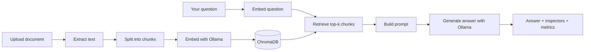

#  Raggy

### Chat with your documents, and see exactly how the answer was made.

Raggy is a **local-first, transparent RAG (Retrieval-Augmented Generation) app**. Upload a document, ask questions, and inspect every step between your question and the answer: the chunks retrieved, their similarity scores, the exact prompt, and the timings.

Built with FastAPI, Next.js, ChromaDB, and Ollama. Runs on your machine.

<!-- Add a demo GIF or screenshot here: docs/demo.gif -->

---

## 😤 The Problem

Chatting with your documents sounds simple. In practice, two things get in the way:

**1. Your documents leave your machine.**
Most "chat with your PDF" tools send your files and questions to a third-party API. That's a problem for contracts, research notes, internal docs, or anything you'd rather keep private.

**2. RAG is a black box.**
You ask a question and get a confident answer. But:

- Which parts of the document did the model actually see?
- Was the right chunk retrieved, or did it miss the relevant page?
- What prompt was really sent to the model?
- Is the answer slow because of embedding, retrieval, or generation?

When an answer is wrong, you have no way to tell whether the retriever, the chunking, or the model is at fault. Debugging becomes guesswork.

## 💡 The Solution

Raggy fixes both:

| Problem | How Raggy handles it |
|---|---|
| Privacy | Embeddings and generation run locally through **Ollama**. No external AI APIs. |
| Opacity | Every answer ships with a **retrieval inspector**, **prompt inspector**, and **performance metrics**. |

It's useful as a private document assistant, and as a hands-on way to learn how RAG pipelines behave.

---

## ✨ Features

- **📄 Document Upload:** PDF, TXT, and Markdown (`.md`).
- **⚙️ Document Processing:** Extract, split, and embed content in the background.
- **🧠 Local Embeddings:** Generated with Ollama (`nomic-embed-text`).
- **🔎 Vector Search:** Relevant chunks retrieved from ChromaDB.
- **💬 Grounded Chat:** Answers based on your uploaded documents.
- **🧪 Retrieval Inspection:** See retrieved chunks, similarity and distance scores, and document references.
- **📝 Prompt Inspection:** View the exact messages sent to the language model.
- **⏱️ Performance Metrics:** Embedding, retrieval, and generation timings, plus token usage.
- **🏠 Local-First:** Models and document processing run on your own machine.

## 🧭 How It Works



1. **Ingest:** your document is extracted, chunked (default 800 characters with 120 overlap), embedded, and stored in ChromaDB.
2. **Retrieve:** your question is embedded and matched against stored chunks to find the top-k most relevant.
3. **Generate:** the retrieved chunks are placed into a prompt and sent to the local language model.
4. **Inspect:** the retrieval results, prompt, and timings are available for every answer.

## 🧰 Tech Stack

| Layer | Technology |
|---|---|
| Frontend | Next.js, React, TypeScript |
| Styling | Tailwind CSS |
| State Management | Zustand |
| Backend | Python, FastAPI |
| Vector Database | ChromaDB |
| Database | SQLite |
| LLM Runtime | Ollama |
| Embedding Model | nomic-embed-text |
| Language Model | qwen3:4b |

---

## 🚀 Quick Start

Raggy needs three services running: **Ollama**, the **FastAPI backend**, and the **Next.js frontend**.

### Prerequisites

| Tool | Version | Download | Verify |
|---|---|---|---|
| Git | any | https://git-scm.com/ | `git --version` |
| Python | 3.10+ | https://www.python.org/downloads/ | `python --version` |
| Node.js | 20.9+ | https://nodejs.org/ | `node --version` and `npm --version` |
| Ollama | any | https://ollama.com/download | `ollama --version` |

Make sure the Ollama service is running before starting the backend.

### 1. Clone the repository

```bash
git clone https://github.com/chiscookeke11/Raggy.git
cd Raggy
```

### 2. Set up the backend

```bash
cd backend
```

**Create a virtual environment**

Windows (PowerShell):

```powershell
python -m venv .venv
.venv\Scripts\Activate.ps1
```

Windows (Command Prompt):

```cmd
python -m venv .venv
.venv\Scripts\activate.bat
```

macOS / Linux:

```bash
python3 -m venv .venv
source .venv/bin/activate
```

**Install dependencies**

```bash
pip install -r requirements.txt
```

**Configure environment variables**

Create a `.env` file inside `backend/`:

```env
RAG_APP_NAME=Raggy
RAG_OLLAMA_HOST=http://localhost:11434

RAG_EMBEDDING_MODEL=nomic-embed-text
RAG_LLM_MODEL=qwen3:4b

RAG_CHUNK_SIZE=800
RAG_CHUNK_OVERLAP=120
RAG_TOP_K=5

RAG_MAX_UPLOAD_MB=25

RAG_TEMPERATURE=0.2
RAG_NUM_CTX=4096
```

These are the default settings. Adjust them to suit your environment.

**Download the Ollama models**

```bash
ollama pull nomic-embed-text
ollama pull qwen3:4b
ollama list   # verify both are installed
```

**Start the backend**

```bash
uvicorn app.main:app --reload --host 127.0.0.1 --port 8000
```

- API: http://127.0.0.1:8000
- Swagger docs: http://127.0.0.1:8000/docs

Keep this terminal running.

### 3. Set up the frontend

Open a new terminal:

```bash
cd Raggy/frontend   # or just `cd frontend` if you're in the project root
npm install
```

Create a `.env.local` file inside `frontend/`:

```env
NEXT_PUBLIC_API_URL=http://127.0.0.1:8000
```

> **Notes**
> - The variable must start with `NEXT_PUBLIC_` so Next.js exposes it to the browser.
> - If your backend runs on a different host or port, update the URL accordingly.
> - Restart the dev server whenever you change `.env.local`.

Start the frontend:

```bash
npm run dev
```

Open http://localhost:3000.

### Running order

| # | Service | Command | Address |
|---|---|---|---|
| 1 | Ollama | Start Ollama | `http://localhost:11434` |
| 2 | FastAPI backend | `uvicorn app.main:app --reload --host 127.0.0.1 --port 8000` | `http://127.0.0.1:8000` |
| 3 | Next.js frontend | `npm run dev` | `http://localhost:3000` |

---

## 🎬 Try It Out

### 1. Check backend health

Visit http://127.0.0.1:8000/health to confirm:

- Ollama connectivity
- Embedding model availability
- Language model availability
- Number of vectors stored

### 2. Upload a document

Go to http://localhost:3000 and upload a `.pdf`, `.txt`, or `.md` file. The backend processes it in the background. **Wait until the status changes to `ready`** before asking questions.

### 3. Ask something

```text
What is this document about?
```

```text
Summarize the main points discussed in the document.
```

```text
What does the document say about machine learning?
```

### 4. Look under the hood 🔬

This is where Raggy differs from most RAG apps. After each answer, you can examine:

- The retrieved document chunks
- Similarity and distance scores
- Embedding and retrieval timings
- Generation and total response timings
- The prompt messages sent to the language model
- Prompt and completion token usage

**Tip:** if an answer looks wrong, check the retrieved chunks first. Was the right passage retrieved at all? Then try tuning `RAG_CHUNK_SIZE`, `RAG_CHUNK_OVERLAP`, or `RAG_TOP_K` and compare.

---

## ⚙️ Configuration

### Backend (`backend/.env`)

| Variable | Default | Description |
|---|---|---|
| `RAG_APP_NAME` | `Raggy` | Application name |
| `RAG_OLLAMA_HOST` | `http://localhost:11434` | Ollama server address |
| `RAG_EMBEDDING_MODEL` | `nomic-embed-text` | Embedding model |
| `RAG_LLM_MODEL` | `qwen3:4b` | Language model |
| `RAG_CHUNK_SIZE` | `800` | Document chunk size |
| `RAG_CHUNK_OVERLAP` | `120` | Overlap between chunks |
| `RAG_TOP_K` | `5` | Default number of retrieved chunks |
| `RAG_MAX_UPLOAD_MB` | `25` | Maximum upload size in MB |
| `RAG_TEMPERATURE` | `0.2` | Language model temperature |
| `RAG_NUM_CTX` | `4096` | Language model context window |

### Frontend (`frontend/.env.local`)

| Variable | Default | Description |
|---|---|---|
| `NEXT_PUBLIC_API_URL` | `http://127.0.0.1:8000` | FastAPI backend base URL |

> 🔒 **Security note:** Do not commit `.env` or `.env.local` files to Git.

```text
Raggy/
├── backend/
│   ├── .env
│   └── ...
└── frontend/
    ├── .env.local
    └── ...
```

---

## 📡 API Reference

Interactive docs are available at http://127.0.0.1:8000/docs.

| Method | Endpoint | Description |
|---|---|---|
| `GET` | `/` | API root |
| `GET` | `/health` | Check application and model health |
| `POST` | `/documents/upload` | Upload a document |
| `GET` | `/documents` | Retrieve uploaded documents |
| `GET` | `/documents/{doc_id}` | Retrieve a document by ID |
| `DELETE` | `/documents/{doc_id}` | Delete a document |
| `GET` | `/chunks/{document_id}` | Retrieve document chunks |
| `POST` | `/chat` | Ask a question |
| `GET` | `/retrieval/{chat_id}` | Retrieve retrieval information for a chat |
| `GET` | `/prompt/{chat_id}` | Retrieve prompt messages for a chat |

**Example: `POST /chat`**

```json
{
  "question": "What is machine learning?",
  "top_k": 5,
  "document_ids": null
}
```

- `question`: the question to ask.
- `top_k`: number of relevant chunks to retrieve (1 to 20).
- `document_ids`: optional list of document IDs to restrict retrieval to.

---

## 🗂️ Project Structure

```text
Raggy/
├── backend/
│   ├── app/
│   │   ├── api/
│   │   ├── core/
│   │   ├── models/
│   │   └── services/
│   ├── requirements.txt
│   └── ...
│
├── frontend/
│   ├── src/
│   │   ├── app/
│   │   ├── components/
│   │   ├── lib/
│   │   └── store/
│   ├── package.json
│   └── ...
│
└── README.md
```

## 💾 Data Storage

Everything is stored locally. The backend creates the required directories and SQLite database automatically.

```text
backend/
└── data/
    ├── uploads/
    ├── chroma/
    └── rag.db
```

| Path | Purpose |
|---|---|
| `data/uploads/` | Uploaded documents |
| `data/chroma/` | ChromaDB vector data |
| `data/rag.db` | Application metadata and chat records |

Keep this directory intact to preserve your documents, vectors, and chat history.

---

## 🛠️ Troubleshooting

<details>
<summary><b>Cannot connect to Ollama</b></summary>

- Ensure Ollama is installed and running.
- Check that `RAG_OLLAMA_HOST` points to the correct address.
- Verify the required models are installed with `ollama list`.
</details>

<details>
<summary><b>Embedding or language model not found</b></summary>

```bash
ollama pull nomic-embed-text
ollama pull qwen3:4b
```
</details>

<details>
<summary><b>Frontend cannot connect to the backend</b></summary>

- Confirm the FastAPI backend is running.
- Confirm `frontend/.env.local` exists and `NEXT_PUBLIC_API_URL` is correct.
- Restart the Next.js dev server after changing the variable.
- If the browser reports a CORS error, make sure the frontend origin is included in the backend's allowed origins.
</details>

<details>
<summary><b>No documents available for chat</b></summary>

- Upload at least one document.
- Wait for processing to finish and the status to read `ready`.
- Confirm the backend successfully generated and stored embeddings.
</details>

<details>
<summary><b>Port already in use</b></summary>

Stop the process using port `8000` or `3000`, or run on another port. If you change the backend port, update `NEXT_PUBLIC_API_URL` to match.
</details>

---

## 🤝 Contributing

Contributions, bug reports, and feature requests are welcome.

1. Fork the repository.
2. Create a branch for your changes.
3. Make your changes and test them.
4. Open a pull request.

## 📄 License

See the repository for license information.

---

**Built with FastAPI, Next.js, ChromaDB, and Ollama.**
[github.com/chiscookeke11/Raggy](https://github.com/chiscookeke11/Raggy)